# Actividad Práctica 6 — HSRP Básico (Redundancia de Gateway)

**Curso:** Redes de Computadoras 1 — Segundo Semestre 2026  
**Estudiante:** Carlos Javier Pérez Pocón  
**Carné:** 202206425  
**Herramienta:** Cisco Packet Tracer 8.2.2

---

## 1. Estructura de la carpeta

```
Actividad6/
├── README.md                                      ← documento de evidencias
├── 202206425_CarlosJavierPerezPocon_HSRP.pkt      ← simulación en Packet Tracer
├── 202206425_CarlosJavierPerezPocon_HSRP.pdf      ← documento final de entrega
├── configs/
│   ├── R1-INF.txt                                 ← router inferior ACTIVO
│   ├── R2-INF.txt                                 ← router inferior STANDBY
│   ├── R3-SUP.txt                                 ← router superior
│   ├── SW-INF.txt                                 ← switch de la red inferior
│   └── PCs.txt                                    ← direccionamiento de las PCs
└── imagenes/                                      ← capturas (ver sección 7)
```

---

## 2. Topología

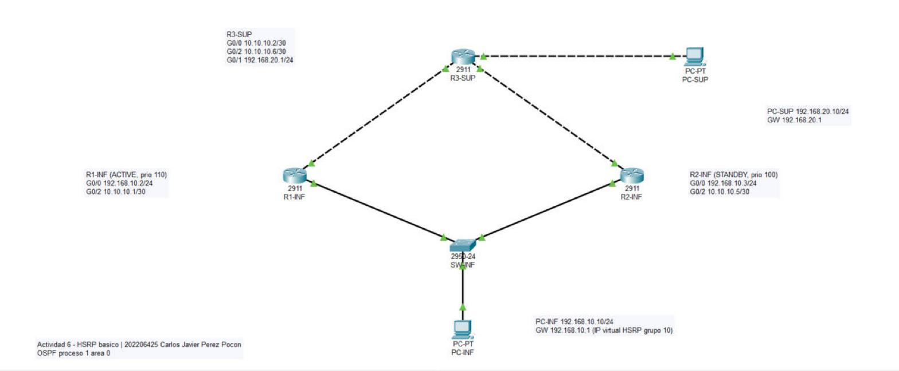

| Dispositivo | Modelo | Función |
|---|---|---|
| R1-INF | Router 2911 | Router inferior — HSRP **Activo** (prioridad 110) |
| R2-INF | Router 2911 | Router inferior — HSRP **Standby** (prioridad 100) |
| R3-SUP | Router 2911 | Router superior, une ambos routers inferiores con la red superior |
| SW-INF | Switch 2960 | Switch de la LAN inferior |
| PC-INF | PC | PC de la red inferior |
| PC-SUP | PC | PC de la red superior |

### Conexiones

| Origen | Puerto | Destino | Puerto | Cable |
|---|---|---|---|---|
| R1-INF | G0/0 | SW-INF | Fa0/1 | Cobre directo |
| R2-INF | G0/0 | SW-INF | Fa0/2 | Cobre directo |
| PC-INF | Fa0 | SW-INF | Fa0/3 | Cobre directo |
| R1-INF | G0/2 | R3-SUP | G0/0 | Cobre cruzado |
| R2-INF | G0/2 | R3-SUP | G0/2 | Cobre cruzado |
| PC-SUP | Fa0 | R3-SUP | G0/1 | Cobre cruzado |

---

## 3. Tabla de direccionamiento

| Red | Uso |
|---|---|
| 192.168.10.0/24 | LAN inferior (HSRP) |
| 10.10.10.0/30 | Enlace R1-INF ↔ R3-SUP |
| 10.10.10.4/30 | Enlace R2-INF ↔ R3-SUP |
| 192.168.20.0/24 | LAN superior |

| Dispositivo | Interfaz | Dirección IP | Máscara | Gateway |
|---|---|---|---|---|
| R1-INF | G0/0 | 192.168.10.2 | 255.255.255.0 | — |
| R1-INF | G0/2 | 10.10.10.1 | 255.255.255.252 | — |
| R2-INF | G0/0 | 192.168.10.3 | 255.255.255.0 | — |
| R2-INF | G0/2 | 10.10.10.5 | 255.255.255.252 | — |
| R3-SUP | G0/0 | 10.10.10.2 | 255.255.255.252 | — |
| R3-SUP | G0/2 | 10.10.10.6 | 255.255.255.252 | — |
| R3-SUP | G0/1 | 192.168.20.1 | 255.255.255.0 | — |
| **HSRP grupo 10** | **IP virtual** | **192.168.10.1** | 255.255.255.0 | — |
| PC-INF | Fa0 | 192.168.10.10 | 255.255.255.0 | **192.168.10.1** (IP virtual) |
| PC-SUP | Fa0 | 192.168.20.10 | 255.255.255.0 | 192.168.20.1 |

---

## 4. Configuración HSRP

| Parámetro | R1-INF | R2-INF |
|---|---|---|
| Interfaz | G0/0 | G0/0 |
| Grupo | 10 | 10 |
| IP virtual | 192.168.10.1 | 192.168.10.1 |
| Prioridad | 110 | 100 |
| Preempt | Sí | Sí |
| Rol inicial | **Active** | **Standby** |
| MAC virtual | 0000.0C07.AC0A | 0000.0C07.AC0A |

```
interface GigabitEthernet0/0
 ip address 192.168.10.2 255.255.255.0
 standby 10 ip 192.168.10.1
 standby 10 priority 110
 standby 10 preempt
```

En R2-INF se usa la misma IP virtual con `standby 10 priority 100`. Como 100 es el valor por defecto, esa línea no aparece en el `show running-config`, pero `show standby` confirma `Priority 100`.

Configuración completa de cada equipo en la carpeta [`configs/`](configs/).

---

## 5. Enrutamiento

Se utilizó **OSPF proceso 1, área 0** en los tres routers:

| Router | Router-ID | Redes anunciadas |
|---|---|---|
| R1-INF | 1.1.1.1 | 192.168.10.0/24, 10.10.10.0/30 |
| R2-INF | 2.2.2.2 | 192.168.10.0/24, 10.10.10.4/30 |
| R3-SUP | 3.3.3.3 | 10.10.10.0/30, 10.10.10.4/30, 192.168.20.0/24 |

R3-SUP aprende la red 192.168.10.0/24 por los dos routers inferiores (dos rutas de igual costo), así que el tráfico de regreso hacia PC-INF tiene un camino alterno cuando uno de ellos falla.

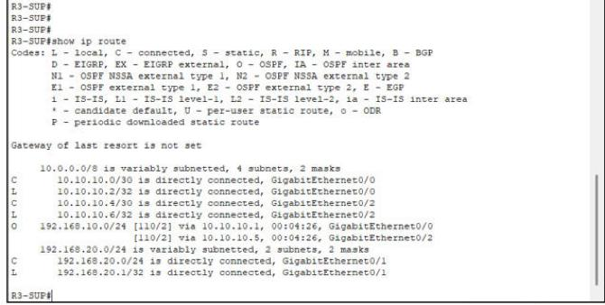

---

## 6. Procedimiento de la prueba

1. Desde **PC-INF** (Desktop → Command Prompt):
   ```
   ping -t 192.168.20.10
   ```
2. Con el ping corriendo, en **R1-INF** se apagó la interfaz LAN:
   ```
   configure terminal
   interface GigabitEthernet0/0
   shutdown
   ```
3. En **R2-INF** se verificó con `show standby brief` / `show standby` que pasó a **Active**.
4. Se observó en PC-INF la pérdida de respuestas y la recuperación del ping.
5. Se levantó de nuevo la interfaz (`no shutdown`) en R1-INF y se comprobó que, gracias a `preempt`, recuperó el rol activo.
6. Se detuvo el ping con `Ctrl+C` para obtener las estadísticas.

### Comandos de verificación usados

```
show ip interface brief
show running-config
show standby
show standby brief
show ip route
show cdp neighbors
```

---

## 7. Evidencias

### 7.1 Configuración IP de la PC inferior (gateway = IP virtual HSRP)
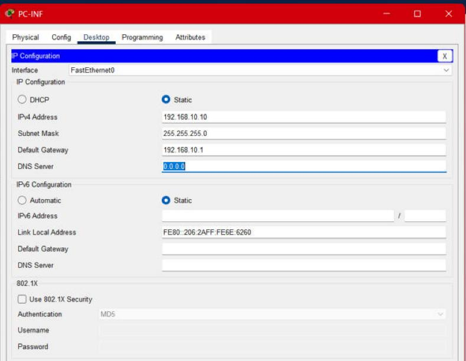

### 7.2 Configuración IP de la PC superior
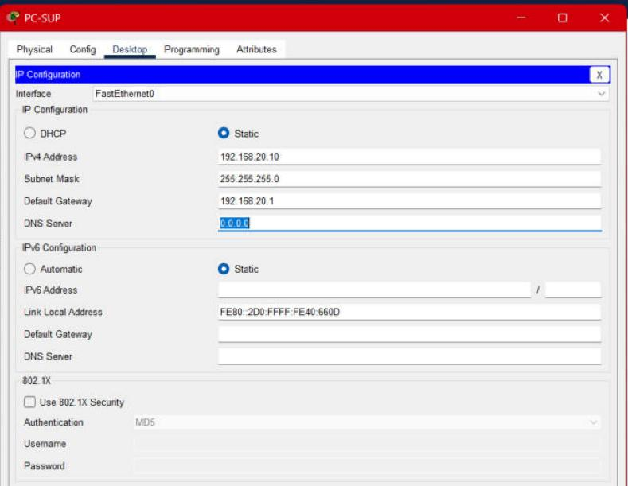

### 7.3 Configuración HSRP del router activo (R1-INF)
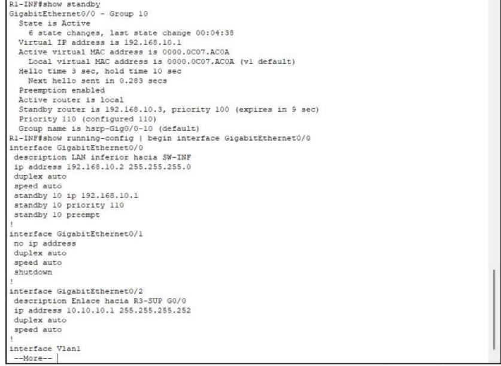

### 7.4 Configuración HSRP del router standby (R2-INF)
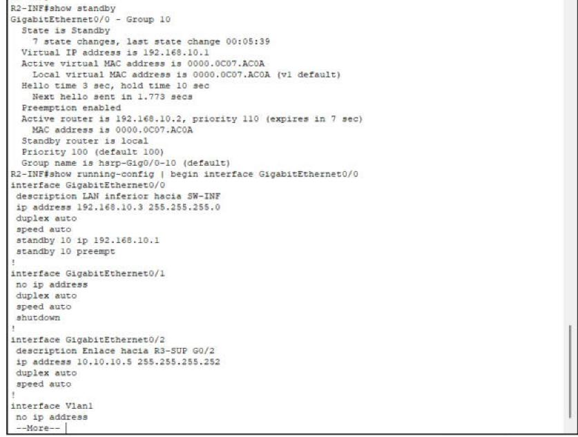

### 7.5 `show standby brief` antes de la falla (R1-INF arriba, R2-INF abajo)
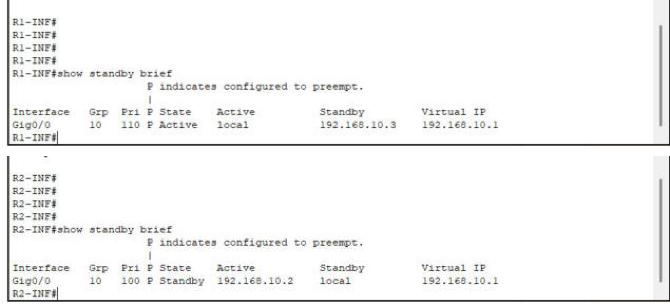

### 7.6 Ping continuo desde PC-INF hacia PC-SUP
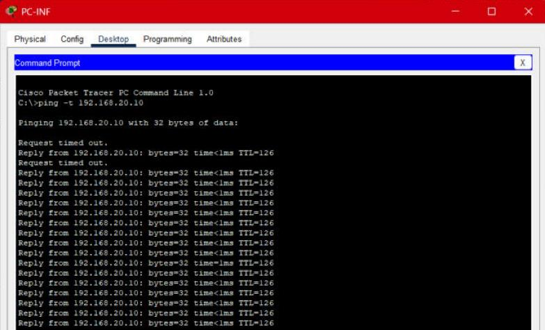

### 7.7 Falla simulada del router activo (shutdown de G0/0 en R1-INF)
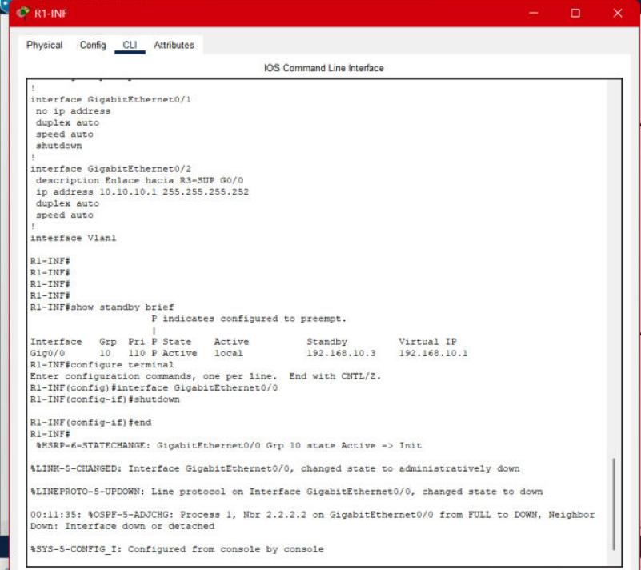

Ping durante la falla: se pierden dos respuestas y luego se recupera.

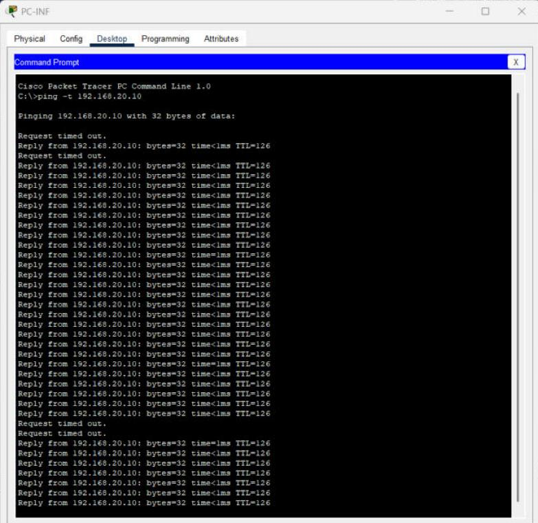

### 7.8 R2-INF asume el rol activo
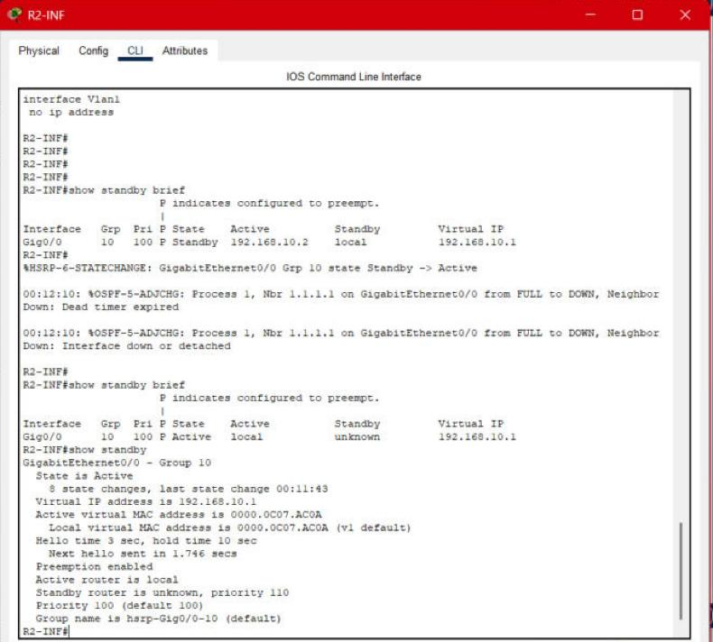

### 7.9 Preempt: R1-INF recupera el rol activo al levantar la interfaz
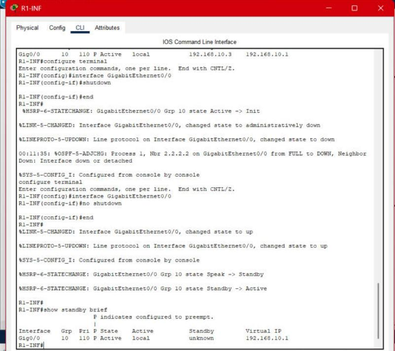

### 7.10 Estadísticas finales del ping
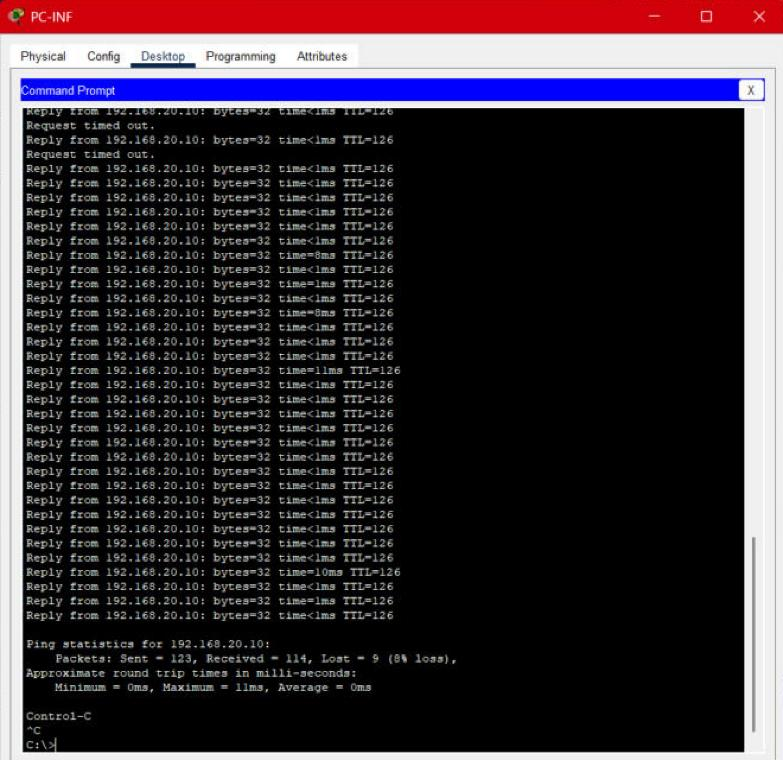

---

## 8. Explicación técnica

**IP virtual utilizada como gateway:** `192.168.10.1`, del grupo HSRP 10, con MAC virtual `0000.0C07.AC0A`. PC-INF tiene esta dirección como gateway y no la IP física de ningún router, por lo que no depende de un equipo en particular.

**Router que inició como activo:** **R1-INF**, por tener la prioridad más alta (110).

**Router que inició como standby:** **R2-INF**, con la prioridad por defecto (100).

**Qué ocurrió cuando falló el router activo:** al apagar G0/0 de R1-INF, este pasó de *Active* a *Init* y dejó de enviar *hellos* HSRP por la LAN. R2-INF registró el cambio `Grp 10 state Standby -> Active` y empezó a responder por la IP virtual y la MAC virtual. La PC no tuvo que cambiar nada, porque su gateway sigue siendo la misma IP y la misma MAC. Al mismo tiempo OSPF bajó la adyacencia por la LAN inferior y R3-SUP siguió llegando a 192.168.10.0/24 por R2-INF.

**Cuánto afectó la falla al ping continuo:** durante el cambio de router activo se perdieron solo **2 respuestas** (`Request timed out`); después el ping siguió con normalidad a través de R2-INF. En toda la prueba se enviaron 123 paquetes y se recibieron 114 (9 perdidos, 8 %): 2 al inicio por la resolución ARP, 2 durante la falla de R1-INF y 5 intermitentes cuando R1-INF volvió y recuperó el rol activo mientras OSPF reconvergía. La interrupción fue de pocos segundos y la conectividad se recuperó sola.

**Función de preempt:** `standby preempt` permite que un router con mayor prioridad tome el rol activo en cuanto vuelve a estar disponible. Al ejecutar `no shutdown` en R1-INF, este pasó por `Speak -> Standby -> Active` y desplazó a R2-INF, que volvió a *Standby*. Sin preempt, R1-INF se habría quedado como *Standby* aunque tenga prioridad 110 y R2-INF seguiría como activo. Con preempt la red vuelve sola a su diseño original.
