# Informe de Desarrollo
## Práctica 2 — Red de la Ciudad Comercial Cayalá

| Campo | Valor |
|---|---|
| Curso | Redes de Computadoras 1 — Segundo Semestre 2026 |
| Estudiante | Carlos Javier Pérez Pocón |
| Carnet | 202206425 |

---

## 1. Objetivo
Diseñar e implementar en Cisco Packet Tracer una red conmutada de capa 2 para cinco zonas reales de Ciudad Cayalá. La red se segmenta con una VLAN por zona y se configura con VTP, Rapid PVST+ y EtherChannel PAgP. Se verificó la conectividad dentro de cada zona, el aislamiento entre VLANs distintas y la tolerancia a fallas de las zonas críticas.

## 2. Desarrollo de la práctica
El trabajo se organizó en fases. Cada fase terminó con su verificación y su commit en el repositorio.

| Fase | Actividad | Resultado |
|---|---|---|
| 1 | Investigación de Cayalá, selección de zonas y diseño en draw.io | Topología híbrida con estrella extendida, malla parcial, anillo y bus |
| 2 | Montaje en Packet Tracer | 9 switches, 14 PCs y 25 enlaces según TIA/EIA-568B, con zonas identificadas por color |
| 3 | Configuración base, VTP, VLANs, troncales y EtherChannel | Dominio VTP 202206425 sincronizado y Po1 en estado SU |
| 4 | Rapid PVST+, puertos de acceso, Blackhole y administración | Root bridges definidos por zona y puertos libres protegidos |
| 5 | Direccionamiento de hosts y pruebas | 11 pruebas intra-VLAN exitosas, aislamiento entre VLANs y análisis de ARP |
| 6 | Pruebas de alta disponibilidad | Comunicación mantenida ante la caída de enlaces |
| 7 | Ajuste del alcance a capa 2 y documentación | Red limitada a la capa de enlace de datos, documentación final |

### 2.1 Diseño
Primero se analizó el rol de cada zona dentro del complejo y con base en ese análisis se decidió cuánta redundancia necesitaba cada una:
- **Administración, Comercial y Seguridad** son críticas y tienen más de un camino hacia la red.
- **Residencial y Gastronomía** usan un solo enlace.

El direccionamiento se calculó con VLSM sobre 192.168.5.0/24, asignando las subredes de mayor a menor tamaño.

### 2.2 Montaje
Se usó un switch 3560-24PS como núcleo y ocho switches 2960-24TT. Los enlaces entre switches se hicieron con cable cross-over y los de hosts con straight-through. El EtherChannel se armó con los dos puertos Gigabit de cada extremo.

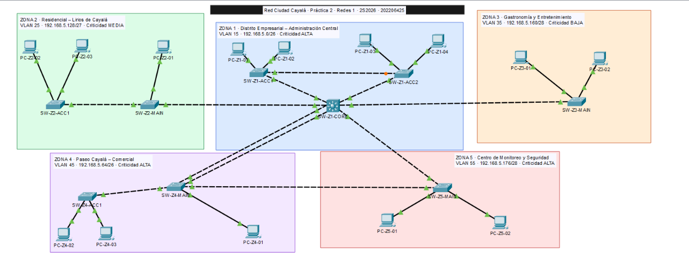

### 2.3 Configuración en dos fases
La **Fase 1** se aplicó en todos los switches: configuración base, VTP, troncales y EtherChannel. Las VLANs se crearon solo en SW-Z1-CORE. Al confirmar con `show vlan brief` que todos tenían las VLANs 15, 25, 35, 45, 55, 99 y 999, se aplicó la **Fase 2**: STP, puertos de acceso, Blackhole y la SVI de administración.

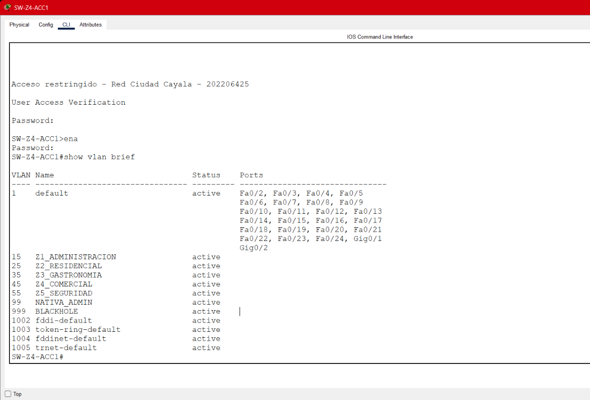

### 2.4 Alcance en capa 2
La práctica corresponde a la capa de enlace de datos. En una primera versión se había habilitado el enrutamiento entre VLANs en el 3560; al revisar el alcance se retiró para que la red quedara exclusivamente en capa 2. El núcleo conserva solo la SVI de la VLAN 99 y cada zona queda aislada en su propio dominio de broadcast.

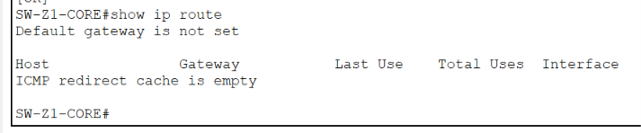

## 3. Problemas encontrados y soluciones

| # | Problema | Causa | Solución |
|---|---|---|---|
| 1 | SW-Z4-MAIN seguía mostrando el prompt `Switch#` después de pegar su configuración | Parte del bloque se perdió al pegarlo en la CLI, incluido el `hostname` | Se volvió a aplicar la configuración completa del switch y se revisó que el prompt mostrara el nombre correcto en los 9 equipos |
| 2 | El EtherChannel quedó en `Po1(SD)` con los puertos en `(I)` (stand-alone) | Los puertos no recibían negociación PAgP del otro extremo; SW-Z4-MAIN tenía una configuración incompleta | Se eliminó el canal en ambos switches (`no channel-group`, `no interface port-channel 1`) y se recreó con parámetros idénticos, sin `switchport nonegotiate` en los miembros |
| 3 | Aun con la configuración correcta, el canal seguía en `(SD)` | Comportamiento del simulador: la negociación quedó detenida | Se guardó la configuración con `write memory` y se reiniciaron SW-Z4-MAIN y SW-Z1-CORE. Tras el reinicio el canal subió como `Po1(SU)` con `Gig0/1(P) Gig0/2(P)` |
| 4 | En `show interfaces trunk` de SW-Z4-MAIN, Fa0/2 solo tenía la VLAN 45 en forwarding | El troncal no estaba completo mientras el switch tenía la configuración a medias | Se resolvió al reaplicar la configuración de SW-Z4-MAIN |
| 5 | Aparecían mensajes `%CDP-4-NATIVE_VLAN_MISMATCH` durante la configuración | Un extremo del troncal ya tenía la VLAN nativa 99 y el otro todavía la VLAN 1 | Desaparecieron al configurar ambos extremos |
| 6 | Riesgo de conflicto de revisión VTP entre los 5 servidores | En modo server, asignar un puerto a una VLAN inexistente la crea y aumenta la revisión | Las VLANs se crearon solo en el núcleo y la configuración se dividió en dos fases |
| 7 | La red incluía enrutamiento inter-VLAN, fuera del alcance de la práctica | Se había habilitado `ip routing` y SVIs por zona en el 3560 | Se retiraron con `no ip routing` y `no interface vlan X`, se eliminó `ip default-gateway` de los switches y se repitieron las pruebas para verificar el aislamiento entre VLANs |
| 8 | Las pruebas de alta disponibilidad no podían hacerse con hosts de distintas zonas | Sin enrutamiento, los hosts solo se comunican dentro de su VLAN | Se usaron las IPs de administración de la VLAN 99, que recorre todos los troncales |

## 4. Resultados

### 4.1 VTP
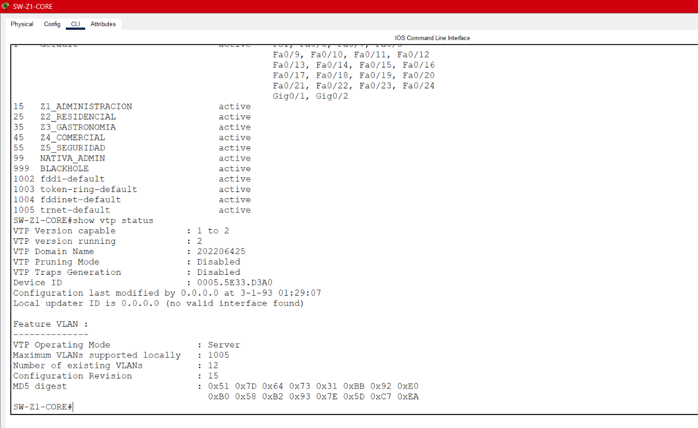
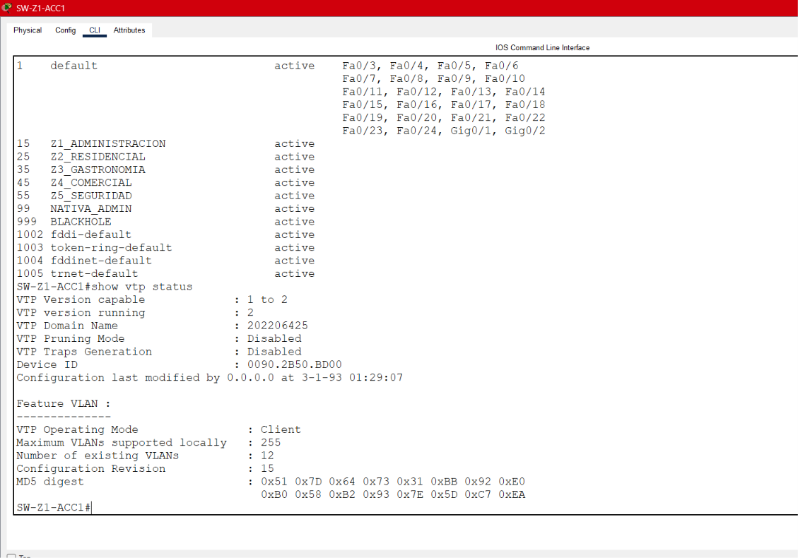

### 4.2 Troncales y EtherChannel
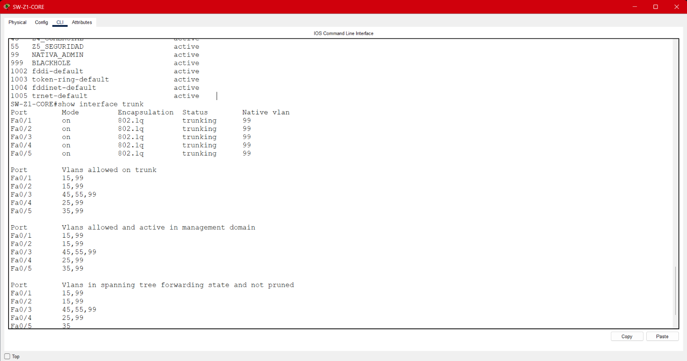
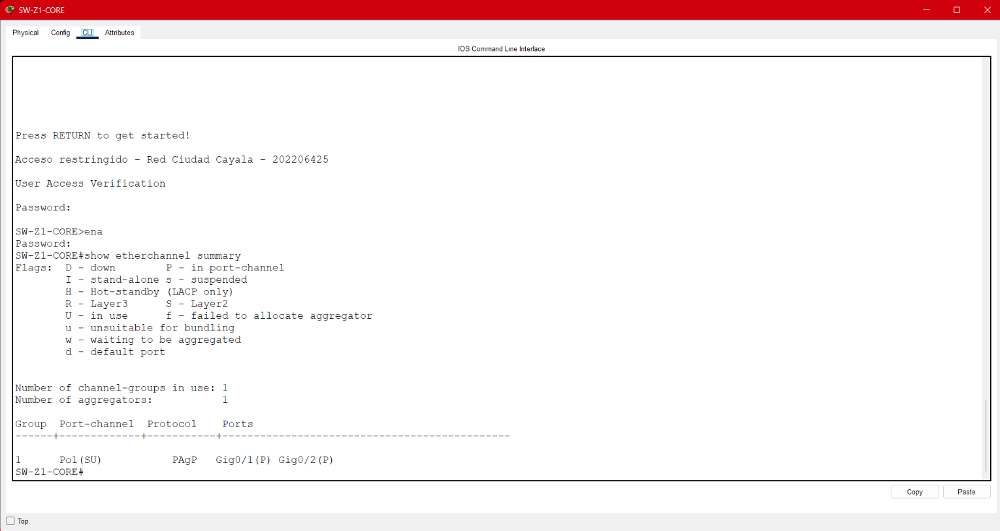
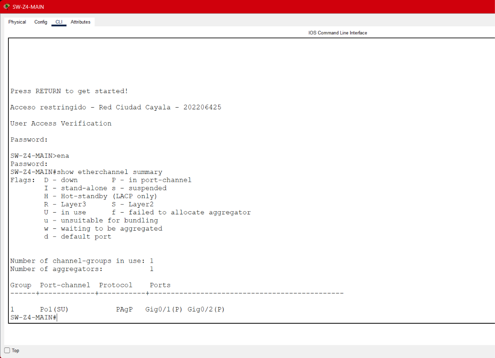

### 4.3 Rapid PVST+
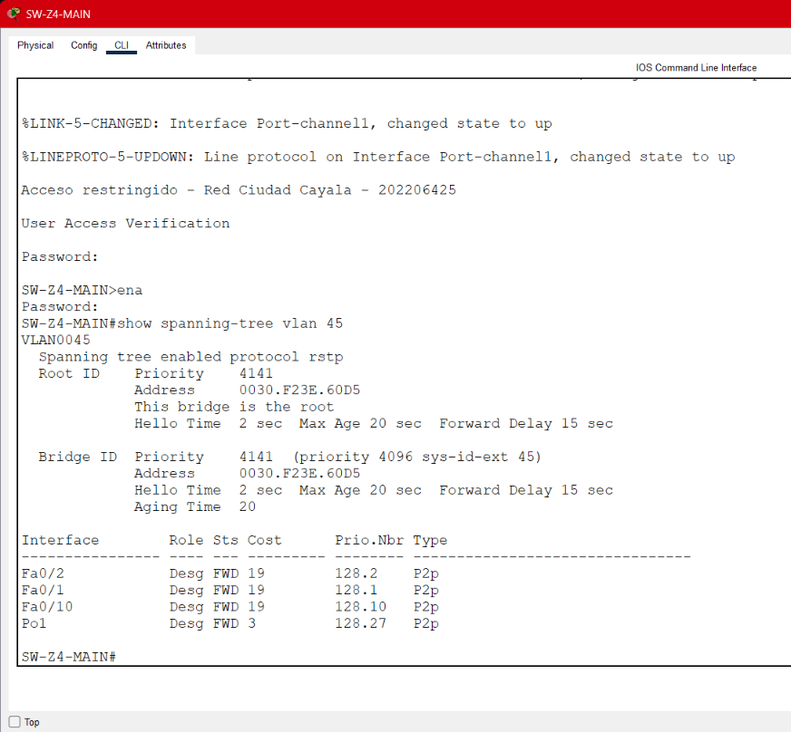
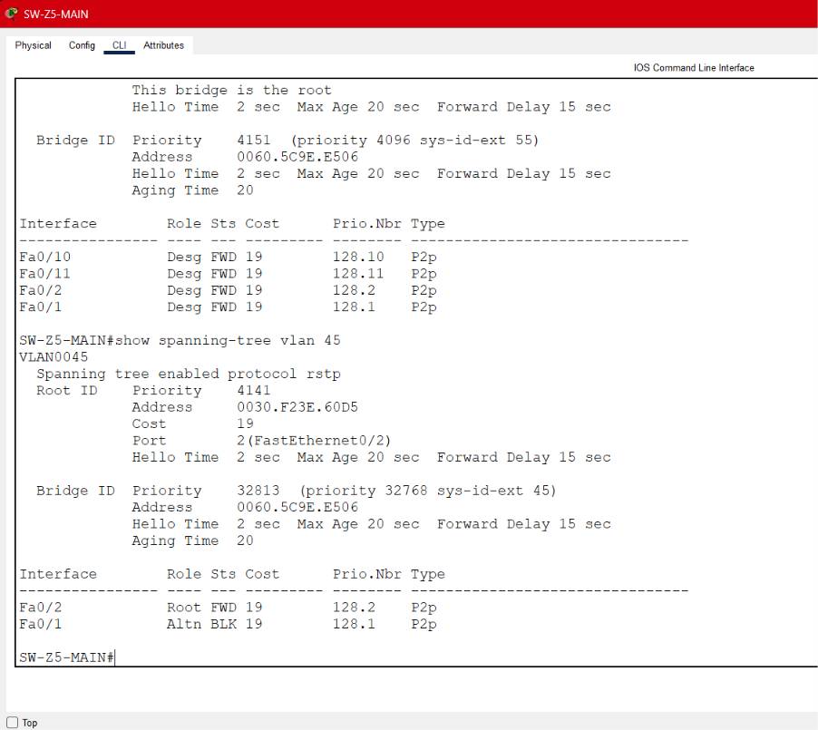

### 4.4 Conectividad y aislamiento
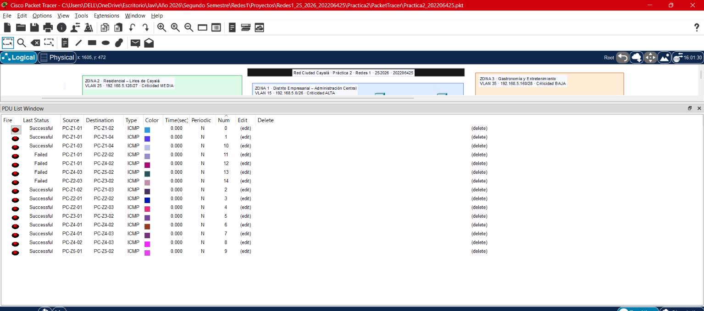
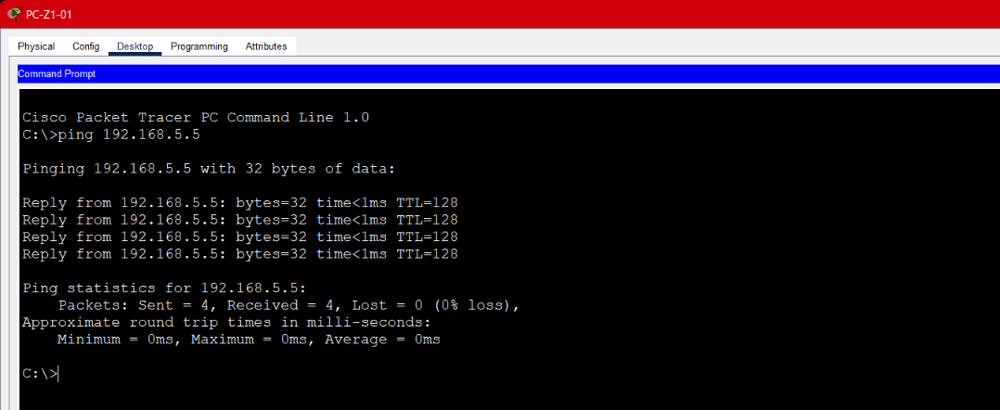
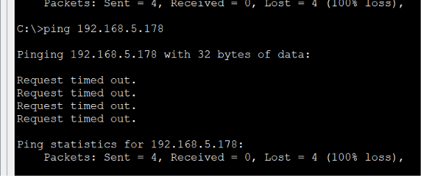

### 4.5 Análisis de ARP e ICMP
En modo simulación, la solicitud ARP de PC-Z1-01 hacia PC-Z1-04 se difundió solo por los puertos de la VLAN 15; ningún host de otra zona la recibió. Al intentar llegar a PC-Z5-01, que está en otra VLAN, el host buscó a su gateway con ARP, no obtuvo respuesta y el paquete ICMP no salió de la Zona 1.

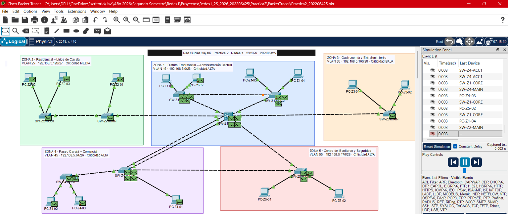
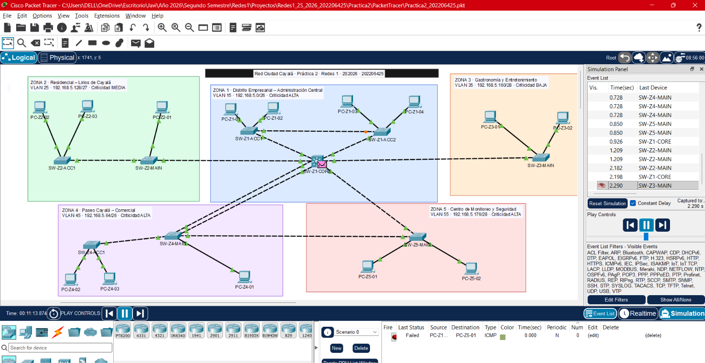

### 4.6 Alta disponibilidad
- Al apagar un cable del EtherChannel, el Port-channel siguió activo con el otro y el núcleo mantuvo la comunicación con la Zona 4.
- Al apagar el enlace Núcleo–Zona 5, Rapid PVST+ cambió el puerto raíz de SW-Z5-MAIN y la comunicación continuó por el EtherChannel y el enlace Z4–Z5.

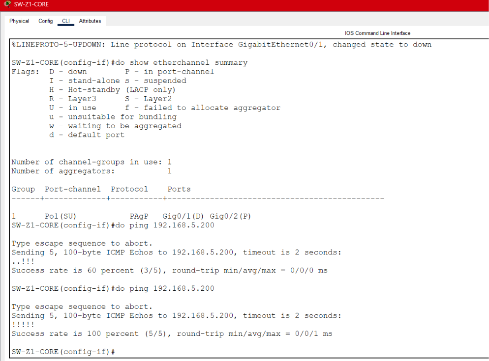
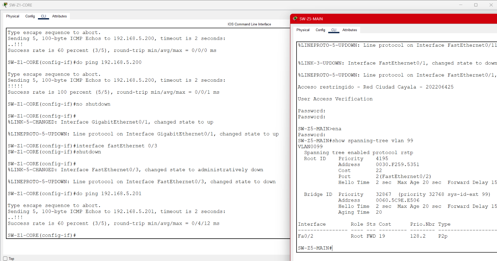

## 5. Conclusiones
1. Asignar una VLAN por zona separó los dominios de broadcast del complejo. Sin un dispositivo de capa 3, cada zona queda completamente aislada de las demás, lo que se comprobó con las pruebas entre VLANs.
2. La topología híbrida permitió invertir en redundancia únicamente donde la criticidad lo justifica. Las zonas Comercial y de Seguridad soportaron la caída de un enlace sin perder comunicación.
3. Fijar la prioridad STP en el switch principal de cada zona hizo predecible el árbol de expansión. Al tener roots distintos por VLAN, la carga se reparte entre los enlaces redundantes.
4. El EtherChannel PAgP duplicó la capacidad hacia la zona comercial sin que STP bloqueara ninguno de sus cables.
5. En un dominio VTP con varios servidores, crear las VLANs en un único switch y configurar por fases evitó inconsistencias en la base de datos de VLANs.
6. El direccionamiento por subred y los gateways reservados dejan la red lista para incorporar enrutamiento en las siguientes prácticas sin rehacer la configuración de los hosts.

## 6. Repositorio
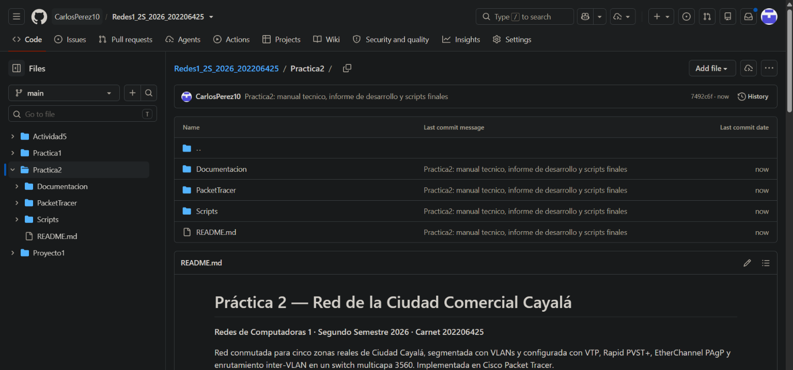
